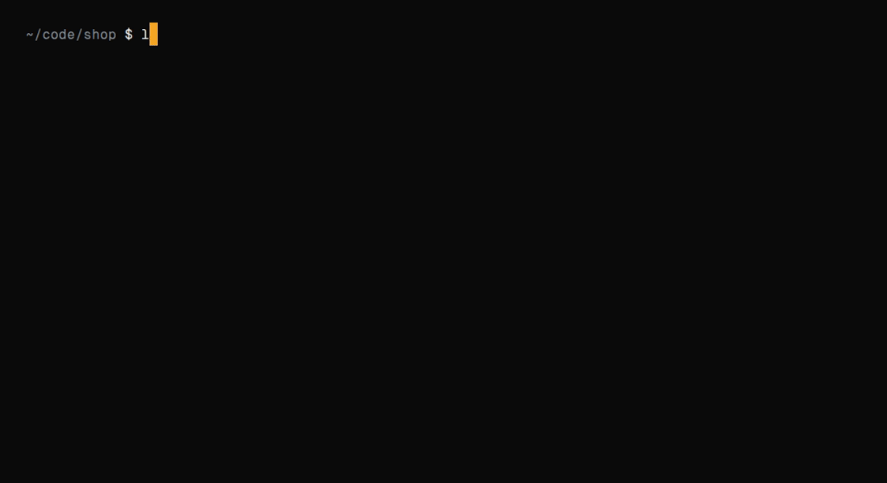

<p align="center">
  <picture>
    <source media="(prefers-color-scheme: dark)" srcset="brand/logo/wordmark-dark.svg">
    
  </picture>
</p>

<p align="center">
  <strong>Ctrl+Z for Agent.</strong><br>
  Undo anything Claude Code, Codex, Gemini or Cursor did to your files. Even <code>rm -rf</code>.
</p>

<p align="center">
  <a href="https://github.com/lintsinghua/oops/actions/workflows/ci.yml"></a>
  <a href="https://github.com/lintsinghua/oops/releases"></a>
  <a href="./LICENSE"></a>
  <a href="https://goreportcard.com/report/github.com/lintsinghua/oops"></a>
</p>

<p align="center">
  English · <a href="./README.zh-CN.md">简体中文</a>
</p>

> **Your agent just wrecked your project? Type `/oops` and jump back to before the conversation in one step.**

- **Whole-turn undo**: Agent changed 30 files in one turn? One command restores them all.
- **Your edits stay safe**: oops tells the agent's changes apart from yours and undoes only the agent's.
- **Change your mind anytime**: Undo and redo freely, back and forth through the full timeline.
- **Never touches `.git`**: Independent snapshots. Your Git history stays exactly as it is.
- **Works right inside your agent**: Hooks into Claude Code, Codex, Gemini CLI and Cursor CLI. No switching tools, just type `/oops` in the chat.

<p align="center">
  
</p>

```sh
go install github.com/lintsinghua/oops/cmd/oops@latest
oops init                         # connect your agents once — then forget about it
```

---

## Why oops

Coding agents are now trusted to run shell commands on their own. Sometimes the command is `rm -rf`, `git clean -fdx`, or a `sed -i` across forty files, and the files it touches were never committed.

The built-in safety nets don't cover this well:

- **Codex** had `/undo`, then removed it in April 2026 ([#8804](https://github.com/openai/codex/issues/8804), [PR #19481](https://github.com/openai/codex/pull/19481)). The request to bring it back, [openai/codex#9203](https://github.com/openai/codex/issues/9203) — *"Please make /undo back"* — is still open with 480 upvotes and 93 comments. The original report: Codex deleted files that weren't tracked by git and changed work that wasn't committed yet. A related request for `/rewind` ([#11626](https://github.com/openai/codex/issues/11626)) has 227 upvotes.
- **Claude Code** checkpoints [don't track changes made through Bash](https://code.claude.com/docs/en/checkpointing) (`rm`, `mv`, `cp`), don't restore background subagent edits, and keep the last 100 checkpoints per session. In auto mode the agent often edits files through Bash, so `/rewind` can report success while restoring nothing ([anthropics/claude-code#87575](https://github.com/anthropics/claude-code/issues/87575)).
- **Gemini CLI** checkpointing is off by default, snapshots only before `write_file` / `replace`, and `/restore` runs `git restore` + `git clean` on the whole shadow repo — which also wipes your own edits.

<sub>Issue counts as of 2026-10-14.</sub>

oops works one level lower, at the file system. Whatever the agent used — its Edit tool, `sed`, a Python heredoc, `rm -rf` — and whether or not the file is in git, the turn can be undone.

## Install

| | |
|---|---|
| Go | `go install github.com/lintsinghua/oops/cmd/oops@latest` |
| Releases | [GitHub Releases](https://github.com/lintsinghua/oops/releases) — macOS, Linux, Windows · amd64 / arm64 |

Homebrew, npm and an install script are coming soon.

## 30-second start

```console
$ oops init

  oops keeps a snapshot before every agent turn, so you can undo it.

  Found 3 agents
    ● Claude Code   ~/.claude/settings.json
    ● Codex         ~/.codex/hooks.json
    ● Gemini CLI    ~/.gemini/settings.json
    ○ Cursor CLI    not found

  Connect all 3? [Y/n/e] ⏎

  ✓ Claude Code   connected · /oops ready
  ✓ Codex         connected · open Codex and run /hooks once to trust oops
  ✓ Gemini CLI    connected

  You're protected.
  When an agent breaks something, just type: oops
```

That's it. Keep working as usual — oops prints nothing while it works.

When something goes wrong, type one word:

```console
$ oops
```

A timeline opens. The latest turn is selected and the right side shows what undoing it would do. Press <kbd>Enter</kbd>, confirm, done.

```console
$ oops undo
✓ Undid turn #42 · claude · "clean up the build scripts"

  restored  39 files   src/ (38), .env
  removed    1 file    scripts/build.mjs
  reverted   1 file    package.json

  Changed your mind? oops redo
```

Inside Claude Code you can also type `/oops` — it runs locally and never reaches the model, so it costs no tokens. Claude Code shows that reply as a hook decision titled "operation blocked by hook". The line that starts with `✓ oops` is the result.

Changed your mind about the setup? `oops init --undo` removes exactly what oops added and leaves the rest of your config alone.

## Commands

You only need to remember `oops`. The rest are shortcuts for people who know what they want, and for scripts.

| Command | What it does |
|---|---|
| `oops` | Open the timeline: pick a turn, preview, undo |
| `oops undo [turn]` | Undo the last turn, or a specific one. `--file <path>` for just some files |
| `oops rewind <turn>` | Go back to before a turn (undoes it and everything after) |
| `oops redo` | Reverse the last undo, rewind or restore |
| `oops restore <path>… --at <turn>` | Bring back files as they were before a turn |
| `oops list` | List recent turns: agent, time, prompt, files changed |
| `oops show [turn]` | Show what a turn changed |
| `oops diff [turn]` | Show a turn's diff (`--stat`, `--name-only`, `--reverse`) |
| `oops init` | Connect oops to the agents on this machine (`--project`, `--print`, `--undo`) |
| `oops run -- <cmd>` | Protect any tool that has no hooks |
| `oops snap [-m msg]` | Save a checkpoint now |
| `oops doctor` | Check that everything works |
| `oops gc` | Free up snapshot storage |

`undo`, `rewind`, `redo`, `restore`, `snap`, and `gc` accept `-n/--dry-run`. `list`, `show`, `diff`, `undo -n`, `doctor`, `snap`, and `gc` accept `--json` (with a `schema_version`). `show --json` includes the file list. Exit codes: `0` ok · `1` error · `2` needs confirmation · `3` partial (conflicting files kept) · `4` nothing to act on · `130` interrupted. The shapes are in [docs/schema.md](docs/schema.md).

## Supported agents

| Agent | Connects through | Turn = | In-session | Notes |
|---|---|---|---|---|
| Claude Code | hooks in `~/.claude/settings.json` | prompt → `Stop` | `/oops` | Runs locally, no tokens. Claude shows it as "operation blocked by hook"; the `✓ oops` line is the result |
| Codex | `~/.codex/hooks.json` | prompt → `Stop` / interrupt | `/oops` when the prompt hook includes that text | Trust the hooks once with `/hooks`. Non-interactive: `codex exec --dangerously-bypass-hook-trust`. `!oops` is not installed |
| Gemini CLI | `~/.gemini/settings.json` | `BeforeAgent` → `AfterAgent` | `/oops` when `BeforeAgent` includes the prompt | Fine alongside Gemini's own checkpointing. No separate slash hook |
| Cursor CLI | `~/.cursor/hooks.json` | prompt → `stop` | `!oops` | In `-p` mode, prefer `oops run -- cursor-agent` |
| Anything else | `oops run -- <cmd>` | session, split after 3 s idle | — | Aider, opencode, your own harness |
| Scripts | `oops snap` | manual checkpoints | — | |

`oops init --project` writes project-level config (e.g. `.claude/settings.json`) so a whole team gets it from the repo.

Planned for v0.2: GitHub Copilot CLI, opencode, Qwen Code, Amp, Goose. [Request an agent →](https://github.com/lintsinghua/oops/issues/new/choose)

## How it works

```
 agent turn starts ──► oops hook returns only after snapshot "pre" is stored
         … agent edits, runs sed, rm -rf, git clean …
 agent turn ends   ──► oops hook returns only after snapshot "post" is stored

 oops undo  ──►  for each file the turn changed:
                   still as the agent left it?  → put back the "pre" version
                   changed since then (by you)? → keep it, tell you why
```

- **Snapshots per turn.** Agent hooks mark where a turn starts and ends. oops snapshots the workspace at both points; the difference is exactly what that turn did, no matter which tool did it.
- **Incremental and content-addressed.** A stat cache means only changed files are read and hashed. Contents are deduplicated, zstd-compressed and immutable — the model is git's (blobs, trees), the storage is not.
- **Your edits are safe.** Undo compares three states per file: before the turn, after the turn, and now. Anything you (or another agent) changed afterwards is kept and reported, not overwritten. Stop records when it starts and when the post snapshot finishes. A file modified inside that window is kept, because the snapshot may already hold those bytes, so a content comparison cannot be trusted. Every other file is kept only when its content differs from the baseline: the post snapshot, or the bytes the latest undo or redo wrote. `--force` overrides, and the overwritten version is saved first.
- **Undo is undoable.** Every undo, rewind and restore takes a safety snapshot first, so `oops redo` always gets you back.
- **Not in your way.** Hook processes always exit 0, and there is no daemon. The turn-start hook stores the pre snapshot before it returns, so a following edit is not what undo restores. The turn-end hook marks the turn ended, stores the post snapshot, and only then returns. A detached process runs retention after that; it does not take the snapshot the agent is waiting on. `oops undo` waits up to 5 seconds for a snapshot that Stop queued and a crash left unfinished, instead of treating the turn as still running. The next turn waits for that post snapshot (at most 30s, then the waiting process finishes it), so the boundary stays intact. If the previous turn is still open, the pre hook closes it from the tree at that moment before storing the new pre snapshot. A later finish does not overwrite that post. If the turn-end process dies during the scan, the job file remains and the next command finishes the turn. Hooks write to stdout only to answer `/oops`, or, on Claude Code, to pass a `systemMessage` when a snapshot was partial or a file was too large to store. Other agents show that notice on the next `oops` command. Each reason is shown once. A hard timeout (default 10s, measured from the start of that scan) marks a snapshot partial and the hook returns.
- **Not in your repo.** Snapshot data is never written inside the workspace. oops does not write to `.git`, create branches, or stash. `oops init --project` is the exception: it writes the agent's own project config, such as `.claude/settings.json`. Snapshots live in `~/.local/share/oops` (`%LOCALAPPDATA%\oops` on Windows). `OOPS_HOME` overrides the data directory.
- **What's included.** Files that are not gitignored, including untracked files, plus protected files even when gitignored (`.env`, `.env.*`, `.envrc`, `*.local`, `*.local.*`, `.dev.vars`, `local.settings.json`). A gitignored path is skipped even if it was force-added. Heavy directories (`node_modules/`, `.venv/`, `target/`, …) are skipped. `dist/` and `build/` are skipped only when a gitignore rule also matches. Tune it with a `.oopsignore` (gitignore syntax). Files over 50 MB are recorded but not stored. `oops doctor`, `oops show`, and the next command say they are unprotected.

Full details: [docs/how-it-works.md](docs/how-it-works.md)

## oops vs. built-in checkpoints

oops doesn't replace your agent's checkpoints — it covers what they miss. Use both: the agent's `/rewind` for the conversation, `oops undo` for the files.

| | Claude Code `/rewind` | Codex | Gemini CLI `/restore` | **oops** |
|---|:-:|:-:|:-:|:-:|
| Built-in undo available | ✓ | removed (Apr 2026) | opt-in | ✓ |
| Changes made through shell (`rm`, `mv`, `sed`) | ✗ | — | only snapshots before `write_file` / `replace` | ✓ |
| Background subagent edits | ✗ | — | — | files written before the turn ends |
| Untracked and gitignored files (`.env`) | — | — | — | ✓ |
| Keeps your own edits made after the turn | — | — | ✗ (whole-repo restore + clean) | ✓ |
| One timeline across agents | ✗ | ✗ | ✗ | ✓ |
| Independent of the agent session | ✗ (per session) | — | — | ✓ |
| History kept | 100 checkpoints / session, ~30 days | — | — | 500 turns or 30 days |
| Rewinds the conversation | ✓ | — | ✓ | ✗ (not a goal) |

<sub>✓ yes · ✗ no · — not applicable or not documented. Sources: [Claude Code checkpointing docs](https://code.claude.com/docs/en/checkpointing), [openai/codex PR #19481](https://github.com/openai/codex/pull/19481), [Gemini CLI checkpointing](https://geminicli.com/docs/cli/checkpointing/). Claude Code `SubagentStop` is recorded and does not split the turn. A file is covered when it is on disk at the parent turn's post snapshot.</sub>

## FAQ

<details>
<summary><strong>Will it slow down my agent?</strong></summary>

It's built not to. Codex's previous `/undo` was removed partly because its snapshots caused problems for users, so this is oops's first rule. Snapshots are incremental (only files whose size, mtime, or mode changed are re-read), excluded directories are pruned without being walked, and each snapshot has a hard timeout (default 10s) after which it is marked partial and the hook returns. The turn-end hook does not return until the post snapshot is stored. The turn-start hook does not return until the pre snapshot is stored.

Measured on 2026-10-14 with `OOPS_PERF=1 go test -count=1 -timeout 45m -run TestHookVisibleLatency ./internal/engine/` (`internal/engine/perf_test.go`). The fixture is N unique 32-byte files across 200 directories. p50 is the 11th sorted sample and p95 is the 20th (nearest-rank) of 21 samples. Machine: 4 vCPU (Intel Xeon on KVM, 1 thread per core), 16 GB RAM, 256 GB virtio disk (ext4 on `/dev/vdc`; the guest reports the disk as rotational), Linux 6.12.94+ x86_64.

This run measured turn-end at 112 ms / 127 ms for 10,000 files and 1.00 s / 1.11 s for 100,000 files, and turn-start at 99 ms / 153 ms and 0.89 s / 0.99 s. A designer measurement of the same kind of tree was higher: about 180 ms for Stop at 10,000 files, about 1.4 s for Stop at 100,000 files, and about 1.2 s for Start at 100,000 files. QA measured Start at 10,000 files at 174 ms p50 / 240 ms p95, above this run. Each cell below is the higher of the measurements. When that figure is above this run's p95, the published p50 and p95 use it.

**Time the agent waits for the turn-end hook to return.** The post snapshot runs inside that process. `TestHookVisibleLatency` builds `./cmd/oops`, takes one cold turn, waits until any queued snapshot is stored, then times 21 `oops hook claude turn-end` processes from start to exit. The process exits after the snapshot is stored.

| Files | Agent waits for turn-end hook, p50 | Agent waits for turn-end hook, p95 |
|---:|---:|---:|
| 10,000 | 180 ms | 180 ms |
| 100,000 | 1.4 s | 1.4 s |

**Time the agent waits for the turn-start hook to return.** The pre snapshot runs inside that process. Same method, timing `oops hook claude turn-start` after the previous post snapshot has finished, so this wait is the pre snapshot plus process startup.

| Files | Agent waits for turn-start hook, p50 | Agent waits for turn-start hook, p95 |
|---:|---:|---:|
| 10,000 | 174 ms | 240 ms |
| 100,000 | 1.2 s | 1.2 s |

The published p50 for a 10,000-file post snapshot is 180 ms. The default 10s timeout marks a snapshot partial and the hook still returns. If the previous post snapshot was killed mid-scan, the turn-start hook waits for the leftover job first, bounded at 30 seconds (`TestWaitPendingBounded`). When that job is already finished, the extra wait is under 50 ms. A dead process does not drop the turn: the job file stays until a later command stores the post snapshot (`TestCrashedChildFinishesTurn`). In-process hot Capture on 2026-10-13, without process startup, was 82 ms / 91 ms at 10k files and 0.82 s / 3.5 s at 100k (`TestHotCapturePercentiles`). The tables above are the later measurement of the wait the agent sees.

**Cold start and memory while scanning.** `TestColdStart10k` times the first in-process Capture of 10,000 files totaling 300,000,000 bytes. On this machine that took 0.69 s (the limit in the PRD is 3 s on Linux). `TestScanRSS100k` sampled VmRSS during a scan of 100,000 files and peaked at 119.5 MiB, 125,341,696 bytes (the limit in the PRD is 150 MB). Measured 2026-10-13. These two figures are one sample each, not a percentile.
</details>

<details>
<summary><strong>What does it store, and where?</strong></summary>

File contents of your workspace (deduplicated and compressed), plus a small SQLite database with turn metadata: agent, time, files changed, and the first line of your prompt (max 200 characters stored, common secrets redacted; set `privacy.record_prompts = false` to turn it off). Everything stays in `~/.local/share/oops` (`%LOCALAPPDATA%\oops` on Windows). On Unix, new data directories are `0700` and object files are `0600`. On Windows, the data directory gets an ACL for the current user. After each post snapshot, retention keeps the last 500 turns or 30 days, and drops the oldest turns past 2 GB per workspace or 10 GB overall. `oops gc` does the same expiry on demand. `oops gc --all` deletes that workspace's snapshots. `oops gc --all --global` deletes every workspace. Unreferenced objects newer than one hour are left in place.
</details>

<details>
<summary><strong>Snapshots include my <code>.env</code>. Is that a problem?</strong></summary>

That's deliberate — a deleted `.env` is one of the most painful losses. The data never leaves your machine and is readable only by your user. If you'd rather not keep a file, exclude it in `.oopsignore`. See [SECURITY.md](SECURITY.md) for the threat model.
</details>

<details>
<summary><strong>How is this different from git?</strong></summary>

git is for history you choose to keep; oops is for the minutes between commits. It covers untracked and ignored files, needs no commits, and never touches your repository — no writes to `.git`, no branches, no stashes. It works in folders that aren't git repos at all.
</details>

<details>
<summary><strong>Does it undo database changes, network calls or installed packages?</strong></summary>

No. oops restores files inside the workspace. Side effects outside it — databases, network requests, global installs, files elsewhere on disk — can't be undone by oops.
</details>

<details>
<summary><strong>Does it rewind the agent's conversation?</strong></summary>

No, that's the agent's job (Claude Code's `/rewind` does it well). Use the agent for the conversation and oops for the files.
</details>

<details>
<summary><strong>What if I edited a file after the agent's turn?</strong></summary>

oops keeps your version and tells you which files it skipped and why (exit code `3`). If you really want the agent's change gone too, the output gives you the exact command (`--force`); your version is saved first.
</details>

<details>
<summary><strong>Does it send anything over the network?</strong></summary>

The commands do not phone home. There is no telemetry and no account. `oops version` prints the version, commit, and build date that were compiled in. `oops version --check` is the only network call: it reads the latest GitHub release.
</details>

<details>
<summary><strong>Windows?</strong></summary>

The same `go test -race ./...` job runs on Linux, macOS, and Windows in CI, including the shared end-to-end scenarios (delete, edit, rename, mode, symlink, Unicode names, empty directories, `.env`, large files, dry-run JSON).
</details>

<details>
<summary><strong>How do I uninstall?</strong></summary>

`oops init --undo` removes the hooks (your other settings stay untouched), `oops gc --all --global` deletes the snapshots, then delete `$(go env GOPATH)/bin/oops`.
</details>

## Contributing

Bug reports, agent adapters and docs fixes are all welcome. Start with [CONTRIBUTING.md](CONTRIBUTING.md): dev setup, `make test`, Conventional Commits, DCO sign-off, and a template for adding a new agent adapter. For bugs, please include the output of `oops doctor --json`.

Security issues: please report privately via [GitHub Security Advisories](https://github.com/lintsinghua/oops/security/advisories/new) — see [SECURITY.md](SECURITY.md).

## License

[MIT](LICENSE)
